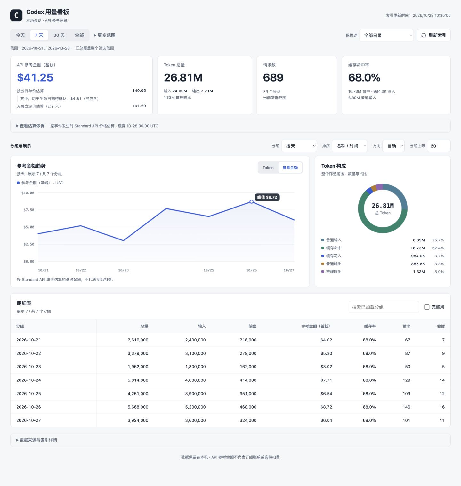

# Codex Token 用量统计

[](https://github.com/ellery97/codex-usage/actions/workflows/ci.yml)
[](LICENSE)

[English version](README.en.md)

一个本地 Codex token 用量统计工具。它读取本机 Codex 会话目录中的 JSONL 日志，
统计输入、缓存读写、输出、推理输出、总 token、请求数、会话数、缓存命中率和参考金额，并提供
命令行输出和本地 Web 仪表盘两种使用方式。

## Dashboard 预览



上图使用示例会话数据，仅用于展示当前 Web 仪表盘的实际渲染效果。

## 数据源

默认会按运行环境发现可访问的数据源；“全部目录”会合并 WSL/Linux 与 Windows 两侧：

```text
# WSL/Linux 侧（在 WSL 中使用本地路径，在 Windows 中使用 \\wsl.localhost 或 \\wsl$ UNC 路径）
~/.codex/sessions/**/*.jsonl
~/.codex/archived_sessions/**/*.jsonl

# Windows 侧（在 WSL/Linux 中使用 /mnt/c，在 Windows 中使用 C:\Users）
/mnt/c/Users/*/.codex/sessions/**/*.jsonl
/mnt/c/Users/*/.codex/archived_sessions/**/*.jsonl
```

不存在或无法访问的目录会被忽略，不会把 `/mnt/c/...` 在原生 Windows 中错误转换为
`E:\mnt\c\...`。原生 Windows 会枚举已安装且可访问的 WSL 发行版及其 `/home/*` 用户目录；
WSL/Linux 会检查可访问的 Windows 用户目录。

工具读取 `event_msg.token_count`、任务开始/结束事件、`event_msg.thread_settings_applied`、`turn_context` 和
`session_meta` 等记录，用于还原 token 用量、轮次、模型、工作目录和会话信息，不输出会话正文。
Web 默认使用本地价格；CLI 默认联网校验价格，Web 也可显式启用。价格校验仅访问固定的 OpenAI 官方模型文档地址，不会上传会话内容。

## 功能

- 按月、按天、按模型、按工作目录、按会话聚合 token 用量。
- 支持全部时间、最近一段时间、今天、自定义起止日期统计。
- 支持文本、JSON、CSV 三种命令行输出。
- 提供本地 Web 页面，展示汇总卡片、Token 用量趋势、Token 构成、索引刷新状态和明细表。
- Web 服务使用 SQLite 持久索引；普通追加只读取新增字节，文件被替换或改写时才回退为完整重扫。
- 全局去重代表事件按数据源范围持久化，筛选变化复用已计价切片和进程内查询缓存。
- 按事件发生时间选择 OpenAI API Standard 价格版本，并区分公开单价估算、无独立定价部分的参考估算和未计价模型。
- 真正缺失时间戳的事件在全量统计中仍会保留并计为未计价；带时间边界的查询会显式报告被排除数量。
- 默认自动发现并合并 WSL/Linux 与 Windows 两侧的当前会话和归档会话目录。
- 默认启用全局去重，减少旧会话内容被复制进后续 rollout 文件后造成的重复计数。

## 环境要求

- Node.js `^22.15.0 || >=23.8.0`，需要内置 `node:sqlite` 与 Zstd 解压流。推荐 Node.js 22 或 24 的最新维护版本。
- 不需要安装第三方 npm 依赖，项目只使用 Node.js 标准库。
- 本机需要存在至少一个可访问的 Codex 会话日志目录。WSL/Linux 默认从 `~/.codex` 开始，
  原生 Windows 默认扫描 `C:\Users\*\.codex`，并在可用时互相发现另一侧环境。

如果启动 Web 服务时报 `No such built-in module: node:sqlite`，请升级 Node.js。

## 快速开始

查看命令行统计：

```bash
npm run usage
```

此命令默认复用与 Web 共用的 SQLite 增量索引，同时统计 `.jsonl` 和 `.jsonl.zst`。首次建立索引或升级扫描器时仍需读取历史日志；
之后只读取变化的文件或新增字节。扫描进度、首次索引/版本升级/文件变化的数量，以及定价和聚合阶段
输出到 stderr，不混入 JSON/CSV 结果。需要把 npm 输出重定向为 JSON 时，使用
`npm run --silent usage -- --json > usage.json`，避免 npm 自身的启动提示进入结果。

CLI 默认仍会联网校验价格。日常只使用本地价格、跳过联网等待时运行：

```bash
npm run usage -- --no-refresh-pricing
```

启动本地 Web 仪表盘：

```bash
npm run web
```

Web 默认使用本地价格，不联网校验，也不执行为校验价格准备的历史模型查询。

也可以在启动时指定端口：

```bash
npm run web -- --port 8899
# 或
npm run web -- -p 8899
```

启动后请打开服务启动日志打印的实际 URL。默认端口可用时为：

```text
http://127.0.0.1:8787
```

运行 smoke 检查：

```bash
npm run smoke
```

手动刷新运行时价格目录：

```bash
npm run update-pricing
```

如果 Web 已经运行，更新价格后需要重启 Web 才会加载新价格。页面上的“刷新索引”只更新用量日志索引。

## macOS 使用

本项目支持在 macOS 上直接运行。在项目根目录执行：

```bash
npm run usage
npm run web
```

然后打开：

```text
http://127.0.0.1:8787
```

使用说明：

- Node.js 版本需满足 `^22.15.0 || >=23.8.0`。
- 项目没有第三方 npm 依赖，正常情况下不需要执行 `npm install`。
- macOS 默认读取 `~/.codex/sessions`。如果日志位于其他目录，可以使用
  `CODEX_HOME=/path/to/.codex npm run usage`，或通过 `--sessions` 显式指定目录。
- 工具不需要 OpenAI API Key，也不会上传会话数据。Web 默认使用本地价格；CLI 默认下载固定的官方模型 Markdown 页面校验价格。

## Web 仪表盘

Web 服务入口是：

```bash
node --no-warnings --expose-gc ./bin/codex-usage-server.mjs
```

对应 npm script：

```bash
npm run web
```

页面优先展示 API 参考金额、Token 总量、请求数和缓存命中率，默认查看最近 7 天。
顶部可快捷选择今天、7 天、30 天和全部；“更多范围”保留 24 小时、12 周及自定义日期。
自定义日期至少填写一端，结束日期不能早于开始日期。

- 日／月分组可切换 **Token / 参考金额** 趋势；金额使用基线参考金额，并同步切换美元坐标轴、峰值与提示。Token 图中的总量、输入和输出共用同一纵轴。模型、目录和会话排名继续按所选排序指标展示。
- 汇总与构成图覆盖整个筛选范围；趋势／排名和明细表仅展示返回的分组，标明“展示 N / 共 M 个分组”。“分组上限”设为 `0` 可显示全部返回分组，排名图最多展示前 18 个。表格搜索仅作用于已加载分组。
- 全宽明细表默认展示核心列，勾选“完整列”可查看缓存读写、推理输出和公开单价估算。窄屏可在表格内部横向滚动，表头和分组列保持固定。
- “查看估算依据”保留金额组成及假设方案说明；“数据来源与索引详情”包含来源路径、扫描信息和去重设置。文件级去重、读取失败、价格缺失等提示持续可见。
- 指标切换、表格搜索、完整列及详情展开仅更新本地展示，不增加查询、扫描或价格检查。趋势图支持鼠标指向及触摸选择；首次加载失败可点“重新加载”。页面使用系统字体，不请求外部字体服务。

页面会请求 `/api/usage`，由后端从 SQLite 索引中聚合数据。默认索引文件是：

```text
.codex-usage/cache.sqlite
```

Web 服务加载已有索引、内置价格和 `pricing-history.json` 后即可监听端口，再在后台补扫历史日志。
已有统计先展示；没有索引时显示“正在建立索引”。补扫期间提示“历史数据尚未补齐”，筛选仍可使用。
默认不联网校验价格，也跳过为价格校验查询历史日志模型的步骤。
需要在本次启动时联网校验，可显式运行：

```bash
CODEX_USAGE_PRICING_REFRESH=1 npm run web
```

也可使用 `npm run update-pricing` 手动更新本地价格目录，更新后重启已运行的 Web 服务。

扫描支持会话目录、归档目录和自定义来源中的 `.jsonl`、`.jsonl.zst`，时间筛选依据事件时间，
不会根据文件名日期跳过扫描。压缩文件使用 Node.js 原生 Zstd 流逐帧解压，不生成解压后的临时日志；
最多同时处理 2 个压缩文件，并受总扫描并发限制。

普通日志保存读取偏移、解析上下文、文件身份和边界哈希；安全追加只读取新增字节。压缩文件首次发现或
大小、修改时间、文件身份变化时完整读取；未变化时不打开、不解压、不做全文件哈希。
同一事件同时存在于两种格式时，全局去重只计一次；`--dedupe-scope file` 仍分别统计每个文件。
本次 schema 增量升级保留已有事件，普通日志扫描器版本保持为 6，无需重建已有版本 6 的索引。

扫描结果分批写入 SQLite 临时暂存表；结束后统一发布成功结果，查询始终读取已发布快照。读取失败的文件
单独列出，已有索引则保留旧统计；普通日志消失而压缩替代文件失败时，也保留对应旧索引。
页面持续提示统计不完整，提供失败详情和重试按钮。启动时跳过未变化的已知失败文件，文件变化或手动刷新时重试。
数据库写入失败、发布冲突或进程中断不会发布本轮暂存结果，下次刷新重新处理。

页面首次加载和筛选只查询当前 SQLite 快照，不等待后台补扫。数据源、范围、分组、排序、方向
和去重条件自动应用，行数与自定义日期使用 200ms 防抖。启动后进行一次后台检查；之后的新日志通过
“刷新索引”手动更新。扫描或可选的后台价格校验期间每秒查询一次状态，完成后按当前筛选加载新结果；
两者均结束后停止轮询。切换来源时丢弃旧请求的状态，保留当前来源的失败提示和重试入口。
进度分别显示源文件读取量和解压后处理量，读完压缩字节不代表解析结束。

Web 的 `24h`、`7d`、`30d` 和 `12w` 范围按当前时间的分钟桶滚动：同一分钟内可复用查询缓存，跨分钟
会生成新的实际边界。`today` 按目标 IANA 时区的日期计算当天 0 点，并在该时区跨日时立即切换。

全局去重结果按规范化的数据源目录组合持久化，文件变化后只修复受影响的事件 key，最多保留
8 个最近使用的范围。旧索引会原地迁移；如果索引中的扫描器版本已过期，升级后的首次索引刷新会逐文件
完整重读日志，以恢复 cache-write、事件指纹、累计 Token key 后缀和可恢复解析状态。成功结果在扫描结束时
统一提交；普通追加继续增量读取。
页面上的“数据源”筛选可以在全部目录、WSL/Linux、Windows 三种口径间切换；WSL/Linux 和 Windows
口径都包含对应环境可访问的当前会话与归档会话。API 仍兼容 `sourceScope=local`，它表示运行时本地
的当前会话目录。

`.codex-usage/` 已写入 `.gitignore`，不会提交到 Git。
运行时价格目录默认保存在同一目录的 `pricing-history.json`。

Web 服务没有认证，默认只监听 `127.0.0.1`。除非增加经过认证且受保护的反向代理，
不要绑定到 `0.0.0.0` 或暴露到不受信任的网络。

## CLI 用法

日常运行（默认启用缓存）：

```bash
npm run usage -- [options]
```

需要无状态完整重扫来排查索引差异时，直接运行原始 CLI：

```bash
node ./bin/codex-token-usage.mjs [options]
```

常用示例：

```bash
# 按月统计全部时间，输出文本表格
npm run usage

# 按天统计 2026-04-01 到 2026-04-30
npm run usage -- --from 2026-04-01 --to 2026-04-30 --group day

# 统计最近 7 天，输出 JSON
npm run --silent usage -- --last 7d --group day --json

# 找出 token 消耗最高的 20 个工作目录
npm run usage -- --group cwd --sort total --desc --limit 20

# 按事件时点 Standard API 参考金额排序模型
npm run usage -- --group model --sort cost --desc --limit 20

# 只统计 Windows 侧 Codex 当前会话
npm run usage -- --sessions /mnt/c/Users/<Windows用户名>/.codex/sessions

# 显式统计 Windows 侧当前会话和归档会话
npm run usage -- --sessions /mnt/c/Users/<Windows用户名>/.codex/sessions --sessions /mnt/c/Users/<Windows用户名>/.codex/archived_sessions

# 显式合并多个会话目录
npm run usage -- --sessions ~/.codex/sessions --sessions /mnt/c/Users/<Windows用户名>/.codex/sessions --sessions /mnt/c/Users/<Windows用户名>/.codex/archived_sessions

# 输出 CSV，方便导入表格
npm run --silent usage -- --group month --csv > codex_usage.csv

# 查看每个 JSONL 文件自身记录的原始口径，关闭跨文件去重
npm run usage -- --dedupe-scope file
```

可用参数：

| 参数 | 说明 |
| --- | --- |
| `--codex-home PATH` | Codex home 目录，默认 `$CODEX_HOME` 或 `~/.codex` |
| `--sessions PATH` | 会话目录，可重复传入；显式传入后不会自动追加默认目录 |
| `--from`, `--since DATE` | 只包含该时间点之后的 token 事件 |
| `--to`, `--until DATE` | 只包含该时间点之前的 token 事件；传 `YYYY-MM-DD` 时包含整天 |
| `--last DURATION` | 最近一段时间，例如 `24h`、`7d`、`4w` |
| `--today` | 从 `--timezone` 指定时区的当天 0 点开始统计 |
| `--group VALUE` | 分组方式：`none`、`day`、`month`、`model`、`cwd`、`session` |
| `--sort VALUE` | 排序字段：`key`、`total`、`input`、`output`、`cached`、`reasoning`、`requests`、`sessions`、`cost` |
| `--asc`, `--desc` | 排序方向；日期分组默认升序，其它分组默认降序 |
| `--limit N` | 限制输出行数；`0` 表示不限制 |
| `--dedupe-scope VALUE` | 去重范围：`global` 或 `file`，默认 `global` |
| `--timezone`, `--tz TZ` | 日期分组和 `--today` 使用的时区，默认本机时区 |
| `--use-cache` | 使用与 Web 共用的 SQLite 增量索引；`npm run usage` 默认添加，原始 CLI 默认完整扫描 |
| `--cache-db PATH` | 指定 SQLite 索引路径，并隐含启用 `--use-cache` |
| `--json` | 输出 JSON |
| `--csv` | 输出 CSV |
| `--no-refresh-pricing` | 不联网刷新价格，使用最近一次已验证的本地目录 |
| `-h`, `--help` | 查看帮助 |

## 统计口径

Codex 会话文件里可能存在两类容易导致重复计数的情况：

1. 同一个 JSONL 文件里重复写入相同累计值的 `token_count`。
2. 较新的 rollout 文件中嵌入较早历史 rollout 的 token 事件。

工具会先在单个文件内按累计 token 向量去重。默认 `--dedupe-scope global` 会进一步使用
“轮次 `turn_id` + 六字段累计 Token + 本次增量 Token”的事件指纹跨文件去重。子 Agent 日志可能复制父任务历史并
改写外层时间戳，但保留原轮次 ID；这些副本只计一次，不同轮次即使用量相同也不会合并。没有可靠轮次 ID 的旧记录
回退到事件时间戳；如果时间戳也缺失，再加入会话/目录/模型身份。

Direct Scan 与 SQLite 使用同一套确定性 canonical 规则：同一事件优先选择有效的 `token_count` 事件时间，
再取其中最早的时间。只有所有副本均缺少有效事件时间时，才使用会话创建时间作为回退；完全未知的时间排在最后。
时间来源和时间相同则按完整文件路径的二进制顺序，其次按文件内事件顺序选择代表事件。选择发生在日期筛选前，
避免副本的写入时间或会话创建时间抢占原件，改变历史月份和价格版本。`--sessions` 参数顺序不会改变模型、cwd、session 和金额归属。

如果你希望查看每个 JSONL 文件自己的原始记录口径，可以使用：

```bash
node ./bin/codex-token-usage.mjs --dedupe-scope file
```

全局去重会先确定 canonical 代表事件，再做时间范围过滤。这个口径更适合看长期真实总量；如果你正在排查
某个文件内部的原始日志，应改用 `file` 去重。

真正无法恢复时间戳的事件不会在全量统计中静默丢失：`range=all` / 无 `from`、`to` 时仍计入请求与 Token，
金额按未计价处理；按天/月分组时进入 `(unknown time)`。一旦查询带有时间边界，因为无法判断这些事件是否位于
区间内，它们会被排除，并通过 `stats.excludedUnknownTimestampEvents` 和
`stats.excludedUnknownTimestampTokens` 明确报告。

## 字段说明

| 字段 | 含义 |
| --- | --- |
| `input_tokens` | 输入 token，包含缓存命中的输入 token |
| `cached_input_tokens` | 输入 token 中命中缓存的部分 |
| `cache_write_input_tokens` | 输入 token 中用于写入缓存的部分 |
| `uncached_input_tokens` | 普通输入，等于 `input_tokens - cached_input_tokens - cache_write_input_tokens` |
| `output_tokens` | 输出 token，包含推理输出 token |
| `reasoning_output_tokens` | 输出 token 中用于推理的部分 |
| `total_tokens` | Codex 记录的总 token，通常等于 `input_tokens + output_tokens` |
| `cache_hit_ratio` | 缓存命中率，等于 `cached_input_tokens / input_tokens` |
| `estimated_cost_usd` | 仅包含有公开价格模型的事件时点美元估算 |
| `assumed_cost_usd` | 明确标注的假设计价基线 |
| `assumed_upper_bound_cost_usd` | 另一参考方案的假设金额，字段名保留，不保证实际费用上限 |
| `reference_total_cost_usd` | 公开单价估算加假设基线 |
| `reference_total_upper_bound_cost_usd` | 公开单价估算加另一方案的假设金额 |
| `priced_requests` | 已匹配到价格表的请求数 |
| `assumed_requests` | 使用明确假设路由的请求数 |
| `assumed_total_tokens` | 使用明确假设路由的 token 数 |
| `unpriced_requests` | 既无官方价格也无假设路由的请求数 |
| `unpriced_total_tokens` | 既无官方价格也无假设路由的 token 数 |
| `provisional_priced_requests` | 使用 provisional 官方价格的请求数 |
| `provisional_priced_total_tokens` | 使用 provisional 官方价格的 token 数 |
| `provisional_estimated_cost_usd` | 公开单价估算中来自 provisional 版本的部分，已包含在总额中 |
| `requests` | token 事件数量，可近似理解为记录到 token 用量的请求数 |
| `sessions` | 参与统计的 Codex 会话数 |

`cached_input_tokens`、`cache_write_input_tokens` 和 `reasoning_output_tokens` 是子集字段，不要再叠加到 `total_tokens` 上。

## 金额估算口径

金额来自版本化价格目录，口径是 OpenAI API Standard 文本 Token 价格。每条有时间戳的事件按自身 UTC 时间选择不晚于它的最新有效版本；恰好位于价格边界时使用新版本。真正没有时间戳的事件无法安全选择历史价格版本，因此会保留在 Token 统计中但标记为未计价。没有权威生效日的旧价格作为 `provisional` 历史基线，不会冒充正式变价日期。

Web 金额卡片显示“API 参考金额（基线）”，由“按公开单价估算”和“无独立定价部分的参考估算”相加得到。后者以 `+金额` 显示，并注明已计入基线总额。“其中，历史生效日期待确认”是公开单价估算中的子集，已包含在总额中，无需再次相加；它表示历史生效日期缺少权威依据，核实后估算可能调整。

展开金额卡片下方的“查看估算依据”，可查看计算关系、历史日期说明，以及各时期采用的参考模型、基线金额和另一方案金额。另一方案的总额通过替换基线假设部分计算，两种方案不叠加，也不构成实际费用的上下限。这些展示调整保留原有 API 字段和金额计算，无需重建索引。

内置目录包含以下 GPT-6 / 6.1 历史价格。生效日采用[官方更新日志](https://developers.openai.com/api/docs/changelog)中的发布日期，按现有约定记录为 UTC 零点；单价来自[官方定价](https://developers.openai.com/api/docs/pricing)，单位为美元 / 百万 Token，表内为“普通上下文 → 长上下文”：

| 模型 | 生效日 | 输入 | 缓存读取 | 缓存写入（30 分钟） | 输出 |
| --- | --- | --- | --- | --- | --- |
| `gpt-6-sol` | 2026-09-22 | 2 → 4 | 0.20 → 0.40 | 2.50 → 5 | 10 → 15 |
| `gpt-6-luna` | 2026-09-22 | 0.10 → 0.20 | 0.01 → 0.02 | 0.125 → 0.25 | 0.50 → 0.75 |
| `gpt-6.1-sol` | 2026-09-29 | 2 → 4 | 0.10 → 0.20 | 2.50 → 5 | 10 → 15 |

单次请求的输入（含缓存）超过 272,000 Token 时，整次请求的输入、缓存读写和输出均使用长上下文单价；恰好 272,000 Token 时仍用普通单价。缓存写入按 30 分钟费率估算，尚未区分 12 小时缓存写入。
本次价格更新复用已有 SQLite 日志索引，重新计算金额即可，无需重建索引；已运行的 Web 服务需重启加载新价格。

内置历史位于 `pricing/openai-pricing.snapshot.json`，运行时校验结果写入数据库旁的 `.codex-usage/pricing-history.json`。
Web 默认合并内置与已缓存的价格，不联网校验；设为 `CODEX_USAGE_PRICING_REFRESH=1` 后，在后台索引发布后联网校验。
校验不阻塞服务启动，完成后页面自动更新价格和校验状态；失败时显示回退告警。仅校验状态变化时仍复用聚合与费用缓存。
CLI 默认仍在聚合和输出前联网校验，可用 `CODEX_USAGE_PRICING_REFRESH=0` 或 `--no-refresh-pricing` 关闭；`--help` 不联网。
联网刷新最多并发 6 个请求且受 8 秒总超时限制，并复用 `ETag` / `Last-Modified`。部分页面失败时，成功模型仍会更新，失败模型继续使用最近一次已验证版本；完全离线时也会回退本地目录。

缓存更新使用锁文件、同目录临时文件和原子 rename。损坏的运行时缓存会先改名保留为 `.corrupt-<timestamp>`，再回退内置目录；内置目录自身无效时会明确拒绝启动。

```text
公开单价估算 =
  (普通输入 × input 单价
   + 缓存命中 × cached input 单价
   + 缓存写入 × cache write 单价
   + 输出 × output 单价) / 1,000,000

参考金额基线 = 公开单价估算 + 假设金额基线
另一方案总额 = 公开单价估算 + 另一方案的假设金额
```

这些数字只是事件发生时的 Standard API 等价参考，不是 ChatGPT 订阅账单、Codex credits 或实际扣费；也不包含 Batch、Flex、Fast、Ultrafast、区域加价、税费和账户折扣。

`codex-auto-review` 没有独立公开价格，因此始终不进入 `estimated_cost_usd`。参考路由按时期展示：2026-04-23 起使用 GPT-5.4 Thinking（low reasoning）基线，2026-07-30 起使用较低证据等级的 GPT-5.6 Luna 基线；两段都以 GPT-5.6 Sol 为另一参考方案（保留 `upperBoundModel` 字段名）。跨时期查询会在 `assumedModels[].routes` 中分别列出请求、Token 和金额。

刷新运行时目录，或只检查差异：

```bash
npm run update-pricing
npm run update-pricing -- --check
```

`--check` 只检查差异，不写入价格缓存。普通更新会写入本地价格目录；已运行的 Web 服务需要重启才能使用新价格。

人工核验出明确生效日后，可将正式版本写入内置历史：

```bash
npm run update-pricing -- \
  --seed \
  --model gpt-5.6-terra \
  --effective-from 2026-07-30 \
  --source-url https://openai.com/index/gpt-5-6/
```

更新器与启动刷新共享同一个解析器：只读取模型页中的 `Pricing / Text tokens`，并要求页面 `Model ID` 与请求模型完全一致。正式版本会保留被替代的 first-observed provisional 记录用于审计，但选择器会忽略已 superseded 的版本。
升级时，若旧临时记录与正式版本的页面哈希和普通价格一致、仅缺少长上下文信息，且正式版本生效日不晚于旧记录，则用正式版本替代该错误解析结果。不同页面内容或不同普通价格的历史记录不会据此被替代。

价格依据：

- `https://developers.openai.com/api/docs/models/<model>.md`
- <https://openai.com/index/gpt-5-6/>
- <https://alignment.openai.com/auto-review/>

## Web 环境变量

端口优先级为命令行 `--port`/`-p`、`PORT`、`CODEX_USAGE_PORT`，最后是默认端口 `8787`。
显式指定的端口不可用时会直接报错，避免脚本或反向代理静默连接到其他端口。未显式指定端口时，
如果 `8787` 因占用或系统保留而无法监听，服务会依次尝试 `9787`、`3000`、`5000`，最后请求
操作系统分配一个临时端口，并在控制台打印实际访问地址。端口值必须是 `0` 到 `65535` 的整数；
`0` 表示请求操作系统分配临时端口。

| 环境变量 | 默认值 | 说明 |
| --- | --- | --- |
| `PORT` | `8787` | Web 服务端口，优先级高于 `CODEX_USAGE_PORT` |
| `CODEX_USAGE_PORT` | `8787` | Web 服务端口 |
| `HOST` | `127.0.0.1` | Web 服务监听地址；服务没有认证，不建议绑定到 `0.0.0.0` 或暴露到不受信任的网络 |
| `CODEX_USAGE_DB` | `.codex-usage/cache.sqlite` | SQLite 索引文件路径 |
| `CODEX_USAGE_PRICING_CACHE` | 数据库旁的 `pricing-history.json` | 运行时版本化价格目录 |
| `CODEX_USAGE_PRICING_TIMEOUT_MS` | `8000` | 启动价格刷新总超时，单位毫秒 |
| `CODEX_USAGE_PRICING_REFRESH` | Web：`0`；CLI：`1` | Web 设为 `1` 时才在启动时联网校验价格；CLI 设为 `0` 可关闭校验 |
| `CODEX_USAGE_SCAN_CHECK_TTL_MS` | `1000` | 文件变更检查 TTL，单位毫秒 |
| `CODEX_USAGE_SCAN_CONCURRENCY` | `8` | 重扫会话文件的并发数，范围会限制在 `1` 到 `32` |
| `CODEX_USAGE_GC` | 非 `0` | 设为 `0` 可关闭 Web 服务中的显式 GC |
| `CODEX_HOME` | `~/.codex` | Codex home 目录，影响默认 sessions 路径 |
| `CODEX_USAGE_SESSIONS` | 空 | 用平台路径分隔符分隔的多个会话目录（Windows 为 `;`，WSL/Linux 为 `:`）；设置后覆盖 `all` 的默认自动发现 |
| `CODEX_USAGE_WINDOWS_ROOT` | 自动推断 | Windows 用户根目录；原生 Windows 默认从 `USERPROFILE` 推断，WSL/Linux 默认 `/mnt/c/Users` |
| `CODEX_USAGE_WSL_DISTROS` | 自动枚举 | 原生 Windows 上要检查的 WSL 发行版，使用 `;` 分隔；未设置时调用 `wsl.exe -l -q` |

示例：

```bash
CODEX_USAGE_PORT=8788 CODEX_USAGE_DB=/tmp/codex-usage.sqlite npm run web
```

显式指定多个数据源：

```bash
CODEX_USAGE_SESSIONS="$HOME/.codex/sessions:/mnt/c/Users/<Windows用户名>/.codex/sessions:/mnt/c/Users/<Windows用户名>/.codex/archived_sessions" npm run web
```

## API

Web 服务提供：

```text
GET /api/usage
GET /api/index/status
POST /api/index/refresh?async=1
POST /api/index/refresh
```

`GET /api/usage` 缺省为只读 SQLite 快照，不触发索引刷新；兼容参数 `refreshIndex=1` 仍可显式请求刷新。
新调用方可使用 `POST /api/index/refresh?async=1` 启动后台刷新，立即返回 `202` 和当前索引状态。
相同数据源的重复请求复用当前任务，其他数据源刷新串行执行。省略 `async=1` 保留同步刷新及原有筛选参数语义。

`GET /api/index/status` 支持 `sourceScope`，返回 `state`、`phase`、`running`、`hasSnapshot`、`incomplete`、
`revision`、`publishedAt`、`pendingFiles`、`completedFiles`、`scannedBytes`、`decodedBytes`、`failedFiles` 和 `failures`。
发现阶段的待处理数量尚未确定；计数指本轮变化文件。每条失败含路径、文件特征、错误、尝试时间、
`retainedPaths` 和 `usingPreviousIndex`。`GET /api/usage` 的 `index` 字段携带同样的状态；原有统计字段保留。
索引发布版本会失效查询/费用缓存，也用于识别其他进程已发布的结果。
状态还包含 `pricingRefresh: { running, revision }`：`running` 表示本次启动的价格校验仍在等待索引或执行中；
`revision` 是当前服务进程内校价流程结束时递增的计数，重启后归零，与索引版本和价格数值版本独立。
即使价格未变或校验失败，页面也能据此更新；查询缓存命中时始终附带最新 `pricing` 元数据。

常用查询参数：

| 参数 | 示例 | 说明 |
| --- | --- | --- |
| `range` | `all`、`today`、`24h`、`7d`、`30d`、`12w`、`custom` | 时间范围；滚动范围按分钟更新 |
| `sourceScope` | `all`、`local`、`wsl`、`windows` | 数据源范围；`local` 保留兼容，`wsl` 和 `windows` 为两个明确环境 |
| `from` | `2026-04-01` | `range=custom` 时的开始日期 |
| `to` | `2026-04-30` | `range=custom` 时的结束日期 |
| `group` | `day` | 分组方式 |
| `sort` | `total` | 排序字段 |
| `asc` / `desc` | `1` | 排序方向 |
| `limit` | `60` | 输出行数 |
| `dedupeScope` | `global` | 去重范围 |
| `refreshIndex` | `0`、`1` | 兼容参数；缺省为 `0`（只读快照），`1` 显式刷新后查询 |

示例：

```text
http://127.0.0.1:8787/api/usage?range=30d&group=day&sort=key&desc=1&limit=60&dedupeScope=global
```

响应保留原有字段，并额外提供 `assumedModels`、`unpricedModels`、provisional 计价汇总，以及
`pricing.mode = "event-time"`、`checkedAt`、`latestEffectiveFrom`、`refreshStatus` 和 `usedFallback`。
`stats` 还包含 `indexRefreshSkipped`、`queryCacheHit`、`costCacheHit`、`scanDurationMs`、
`dedupeDurationMs`、`aggregationDurationMs`、`totalDurationMs`、`incrementalFiles`、
`fullRescanFiles`、`scannedBytes`、`decodedBytes`、`failedFiles`、`unknownTimestampEvents`、`unknownTimestampTokens`、
`excludedUnknownTimestampEvents` 和 `excludedUnknownTimestampTokens`。查询缓存命中时各阶段耗时为 `0`，
`totalDurationMs` 始终是当前请求耗时。

## 项目结构

```text
.
├── bin/
│   ├── codex-token-usage.mjs      # CLI 公共入口
│   ├── codex-token-usage-core.mjs # 参数、数据源与基础工具
│   ├── codex-usage-server.mjs     # 本地 Web 服务与后台补扫
│   ├── session-scanner.mjs        # 可恢复的增量 JSONL 扫描器
│   ├── usage-aggregation.mjs      # Direct/Cache 一致的聚合与 CLI 输出
│   ├── usage-index.mjs            # SQLite 索引、迁移与计价切片
│   ├── usage-index-view.mjs       # 索引查询的 unknown-time 正确性层
│   ├── usage-canonical.mjs        # 持久化全局去重范围
│   ├── usage-query.mjs            # 查询结果 LRU 与缓存只读链路
│   ├── openai-pricing.mjs         # 价格目录服务入口
│   ├── pricing-catalog.mjs        # 版本选择和事件时点计价
│   ├── pricing-refresh.mjs        # 官方模型 Markdown 校验与运行时缓存
│   └── update-pricing.mjs         # 手动价格更新器
├── pricing/
│   └── openai-pricing.snapshot.json # 内置版本化价格历史
├── public/
│   ├── index.html                 # 仪表盘页面
│   ├── app.js                     # 前端交互、图表和表格渲染
│   └── styles.css                 # 页面样式
├── test/                           # 计价、刷新和聚合边界测试
├── .github/                       # CI、Dependabot、Issue/PR 模板
├── LICENSE
├── CHANGELOG.md
├── CONTRIBUTING.md
├── SECURITY.md
├── CODE_OF_CONDUCT.md
├── package.json
├── package-lock.json
├── README.en.md
└── README.md
```

## 开源协作

- 贡献流程见 [CONTRIBUTING.md](CONTRIBUTING.md)。
- 安全漏洞请按 [SECURITY.md](SECURITY.md) 私下报告，不要直接创建公开 Issue。
- 行为规范见 [CODE_OF_CONDUCT.md](CODE_OF_CONDUCT.md)。
- 本项目只处理本机 Codex 日志；请勿提交会话 JSONL、SQLite 数据库、提示词或其他个人数据。

## 常见问题

### 为什么打开后历史统计仍在增加？

Web 会先展示已发布索引，后台补扫压缩历史日志。首次补扫需要解压并解析历史数据，期间会提示数据尚未补齐。
未变化的压缩文件之后直接复用缓存。普通日志保持扫描器版本 6，只有更旧的解析缓存需要升级重读。

### 读取失败时 CLI 如何处理？

可用统计正常输出，stderr 列出失败文件；退出码 `2` 表示统计不完整，`1` 表示命令无法完成。
JSON/CSV stdout 保持可解析。再次运行同一命令可重试；缓存模式下已有数据的失败文件保留上次索引，
无缓存完整扫描只包含本次成功读取的文件。Web 可通过失败提示中的重试按钮或异步刷新 API 重试。

### 会不会把会话内容上传出去？

不会。这个工具只在本机读取本地 JSONL 文件，Web 服务也只监听本地地址 `127.0.0.1`。
Web 默认不联网校验价格。CLI 默认校验、显式启用的 Web 启动校验，以及手动价格更新只会向固定的
`developers.openai.com` 模型 Markdown 地址请求价格，不会发送会话内容。

### 为什么同一时间范围下 `global` 和 `file` 统计结果不同？

`global` 会跨文件去重，适合看长期真实消耗；`file` 只在单个文件内去重，适合排查某个
JSONL 文件的原始记录。旧版 Codex 可能把历史 rollout 内容复制进新文件，因此 `file`
口径通常会更接近“文件记录量”，但可能高估真实 token 消耗。

### 为什么 Web 和 CLI 的速度不同？

`npm run usage` 默认复用增量索引；直接运行原始 CLI 默认完整扫描，也可通过 `--use-cache` 复用索引。Web 的筛选请求使用
`refreshIndex=0`，只读取 SQLite、持久化全局去重结果、计价切片和最多 64 项查询结果缓存；
启动后台检查和“刷新索引”会访问日志文件，因此筛选不会再次走扫描流程。

## 开发验证

扫描基准使用合成日志，独立进程运行至少 5 次，输出耗时中位数、峰值 RSS、源文件/解压字节数、扫描期间 API 延迟：

```bash
npm run benchmark:scan
# 可调整无关日志体积（MiB/压缩文件）；固定用量事件数，观察内存是否随体积线性增长
node bin/benchmark-session-scan.mjs --runs=5 --sizes=8,32,128
```

本次验证结果见 [压缩日志扫描验证记录](docs/compressed-scan-validation.md)。

覆盖首次建索引、未变化重跑、仅追加普通日志、仅修改一个压缩文件；断言未变化读取/解压量为 0，
追加普通日志不重读压缩历史，首次补扫完成前 HTTP 可查询。跨版本与跨平台检查见 CI。

语法检查：

```bash
node --check bin/codex-token-usage.mjs
node --check bin/codex-token-usage-core.mjs
node --check bin/codex-usage-server.mjs
node --check bin/openai-pricing.mjs
node --check bin/pricing-catalog.mjs
node --check bin/pricing-refresh.mjs
node --check bin/session-scanner.mjs
node --check bin/usage-aggregation.mjs
node --check bin/usage-index.mjs
node --check bin/usage-index-view.mjs
node --check bin/usage-query.mjs
node --check public/app.js
```

功能 smoke：

```bash
npm run smoke
npm run benchmark:index
node ./bin/codex-token-usage.mjs --group month --limit 1
node ./bin/codex-token-usage.mjs --group month --limit 1 --csv
```
